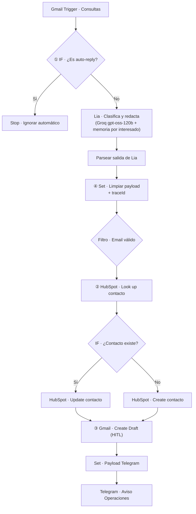

# Checkpoint 4 · Lia para Brújula Propiedades

**Integraciones Avanzadas e Interconexión de Sistemas** · Curso de Agentes de IA con n8n
Autor: **Valentín Turco**

Este workflow es el **canal email** de *Lia*, la agente de atención y calificación de interesados que vengo construyendo módulo a módulo para **Brújula Propiedades** (inmobiliaria ficticia de CABA). Parte del Manager del Módulo 3 (mismas reglas de negocio, mismo modelo Groq `openai/gpt-oss-120b`, memoria por interesado y `traceId`) y lo conecta con tres herramientas reales (Gmail y HubSpot vía **OAuth2**, Telegram vía token de bot):

| Rol en el caso del vivo | Herramienta | Para qué se usa |
|---|---|---|
| CRM / fuente única de verdad | **HubSpot Free** | Buscar, actualizar y crear el contacto del interesado |
| Casilla de soporte | **Gmail** | Leer las consultas entrantes y dejar la respuesta en Borradores |
| Canal del equipo | **Telegram** (grupo *Operaciones Brújula*) | Avisar a los corredores que hay un borrador para aprobar |

> No hizo falta simular el CRM con un formulario HTML: HubSpot tiene un CRM gratuito y n8n trae el conector nativo.
>
> **Por qué Telegram y no Slack:** con n8n self-hosted en `localhost`, Slack no acepta Redirect URLs que no sean https, así que conectarlo exigía exponer n8n a internet con un túnel. Telegram cumple el mismo rol (canal del equipo, mensajería masiva), es gratis, tiene nodo nativo en n8n y es el canal que Lia va a usar para la voz en el Módulo 6. La consigna permite reemplazar herramientas mientras se respete el rol.

## Archivos

| Archivo | Contenido |
|---|---|
| `checkpoint4_valentin_turco.json` | Workflow exportado desde n8n (Workflow › Download) |
| `README.md` | Este documento |
| `img/credenciales_n8n.png` | Captura de **Credentials** con las 3 conexiones activas |

## Flujo

**Lectura (pasado):** Gmail Trigger y Look up en HubSpot.
**Escritura (futuro):** Update/Create en HubSpot, borrador en Gmail y mensaje en Telegram.

## Los 4 nodos clave de la rúbrica

### ① IF anti auto-reply → corta el bucle infinito
Está **inmediatamente después del trigger**. Con condiciones visuales unidas por **OR**, manda a *Stop* cualquier mail que:
- tenga en el asunto `auto-reply`, `autoreply`, `automatic reply`, `respuesta automática`, `out of office`, `fuera de la oficina`, `undeliverable`, `delivery status notification` o `mail delivery failed`;
- venga de un remitente `no-reply`, `noreply`, `mailer-daemon` o `postmaster`;
- traiga el header estándar `Auto-Submitted: auto-*`.

Además, el trigger solo toma mails no leídos enviados al alias de consultas y excluye los enviados por la propia casilla (`-from:me`), así Lia nunca procesa sus propias respuestas.

### ② Look up antes del Create → evita el Error 409
*HubSpot · Look up contacto* busca por email (operación **Search**, `limit 1`, devuelve solo `email` y `firstname`). Tiene *Always Output Data* para que, si no encuentra nada, el flujo siga igual hacia el IF:
- **Existe** → *Update*: solo agrega la última consulta en el campo *Message* (no pisa nombre ni etapa del ciclo de vida).
- **No existe** → *Create*: alta como `lead` con nombre, teléfono y la consulta.

### ③ Create Draft → guardrail Human-in-the-loop
La única operación de salida de correo es **Draft › Create**, en el **mismo hilo** de la consulta (`threadId`) y dirigida al interesado. Lia nunca envía: un corredor revisa el borrador en Gmail › Borradores y decide si lo manda. Cumple la regla fija del proyecto: reservas, señas, ofertas y visitas con día y hora siempre las confirma un humano.

### ④ Set de limpieza → evita el Error 400
*Set - Limpiar payload* deja **solo 15 campos de texto** (email, nombre, datos de la búsqueda, intención, calificación, resumen, borrador, asunto, threadId y `traceId`) y descarta HTML, adjuntos y headers. Cada campo tiene un largo máximo. Después, *Filtro - Email válido* deja pasar solo si:
- el email no está vacío y cumple `^[^\s@]+@[^\s@]+\.[^\s@]+$`;
- hay un borrador para guardar;
- la intención no es `FUERA_DE_AMBITO` (spam o publicidad no entran al CRM).

Antes de Telegram hay un segundo Set (*Payload Telegram*) que arma un mensaje corto con lo mínimo que necesita el equipo: nada de cuerpos completos ni binarios en el canal.

## Reglas de negocio que Lia aplica (heredadas del M3)

- **Intenciones:** `INTERESADO_COMPLETO` · `ESCALAR` · `CONVERSACION` · `FUERA_DE_AMBITO`.
- **Scorecard:** CALIENTE (garantía o pago válido y mudanza ≤ 2 meses) · FRÍO ("solo mirando", "más adelante" o mudanza > 6 meses) · TIBIO (el resto) · ESCALAR.
- **Nunca** inventa precio, expensas, superficie ni disponibilidad, y nunca pregunta ni registra nacionalidad, religión, edad, estado civil, hijos u orientación sexual.
- El contenido del mail va entre delimitadores `[INICIO DEL EMAIL] … [FIN DEL EMAIL]` y se trata como datos, no como instrucciones (defensa contra prompt injection).
- **traceId** `bru-yyyyMMdd-<execution.id>`: viaja a HubSpot (campo *Message*) y a Telegram, para rastrear cada caso de punta a punta.

## Credenciales y mínimo privilegio

| Conector | Credencial | Operaciones que usa el workflow | Cómo se acota el acceso |
|---|---|---|---|
| Gmail | Gmail OAuth2 | Leer mensajes nuevos (trigger) y crear borradores | El trigger solo ve los mails enviados al alias de consultas (`to:<casilla>+brujula@gmail.com -from:me`), así el resto de la casilla nunca llega al agente ni al modelo. El workflow no tiene ningún nodo *Send*, *Delete* ni de etiquetas. En producción, la inmobiliaria usaría una casilla dedicada. |
| HubSpot | HubSpot OAuth2 | Buscar, crear y actualizar **contactos** | Solo se tocan contactos (ni negocios, ni empresas, ni tickets). La búsqueda devuelve únicamente `email` y `firstname`, y se escriben solo nombre, teléfono, etapa y mensaje. |
| Telegram | Telegram API (token de bot) | Enviar un mensaje | Bot dedicado, agregado solo al grupo de operaciones. El nodo usa únicamente *Send Message* a un `chatId` fijo: no lee mensajes ni archivos. El token no tiene scopes: el límite lo pone el bot (solo está en ese grupo). |

**Aclaración honesta:** las credenciales OAuth2 de n8n (Gmail y HubSpot) piden un conjunto de scopes definido por el propio conector, que no se puede recortar desde la credencial. Por eso el mínimo privilegio se aplica en tres capas: cuentas y canales dedicados, solo las operaciones necesarias en cada nodo y solo los campos necesarios en cada payload.

### Cómo conectarlas

- **n8n Cloud:** en cada credencial, *Connect my account* y autorizar en el navegador.
- **n8n self-hosted:**
  - *Gmail:* proyecto en Google Cloud con la API de Gmail, pantalla de consentimiento y cliente OAuth (tipo *Web*) con la *OAuth Redirect URL* que muestra n8n. Si la app queda en modo prueba, los tokens vencen a los 7 días: reconectar antes de probar.
  - *HubSpot:* desde 2026 HubSpot ya no deja crear apps públicas desde la web; se crean con la **HubSpot CLI** (`hs project create` → App, distribución privada, autenticación OAuth). En `app-hsmeta.json` se cargan la *OAuth Redirect URL* de n8n y los scopes que pide el conector de n8n; después `hs project upload` y se copian Client ID y Client Secret desde la pestaña *Auth* de la app. Si aparece un error de scopes, los de la app tienen que coincidir con los que envía n8n.
  - *Telegram:* crear el bot con **@BotFather** (`/newbot`) y pegar el token en la credencial *Telegram API*. Crear el grupo *Operaciones Brújula*, agregar el bot, mandar un mensaje y obtener el `chatId` del grupo (número negativo) con `https://api.telegram.org/bot<TOKEN>/getUpdates`.

## Cómo importarlo y probarlo

1. En n8n: **Workflows › Import from File** y elegir `checkpoint4_valentin_turco.json`.
2. Asignar las credenciales en los nodos de Gmail (trigger y draft), HubSpot (los 3), Telegram y Groq.
3. En *HubSpot - Look up contacto*, confirmar que la propiedad del filtro sea **Email** (si aparece vacía, volver a elegirla de la lista).
4. En *Telegram - Aviso Operaciones*, reemplazar `PEGAR_CHAT_ID_DEL_GRUPO` por el `chatId` del grupo.
5. Revisar que los campos de los Set estén en modo **Expression**.

### Test de regresión manual

| # | Prueba | Resultado esperado |
|---|---|---|
| 1 | Mail desde otra cuenta: "Hola, me interesa el 2 ambientes de Palermo en alquiler, soy Ana, tengo garantía propietaria y me mudo en enero" | Contacto nuevo en HubSpot, borrador en el hilo, aviso en Telegram con calificación CALIENTE |
| 2 | Segundo mail desde la misma cuenta | Rama **Update**: no se crea un contacto duplicado; Lia no vuelve a pedir datos que ya tiene |
| 3 | Mail con asunto "Automatic reply: Out of office" | Termina en *Stop*; no hay borrador ni aviso |
| 4 | Mail que pide reservar o hacer una oferta | Intención `ESCALAR`; el borrador no promete nada y deriva a un corredor |
| 5 | Publicidad o spam | `FUERA_DE_AMBITO`: el filtro lo frena antes del CRM |

Cada nodo se probó con **Test step** y el flujo completo con **Execute Workflow** antes de exportar.

## Pendiente para el Proyecto Final (M11)

- Portales (Zonaprop, Argenprop) mandan los avisos desde direcciones `noreply`: hará falta una lista blanca de esos dominios y leer el email del interesado desde el *Reply-To* o el cuerpo.
- Rama de error con alerta a Telegram cuando falle HubSpot o Gmail, y aviso de los mails que frena el filtro.
- Juez (M8) antes de escribir en el CRM y propiedad `origen: Lia` en HubSpot para medir el success fee (M10).
